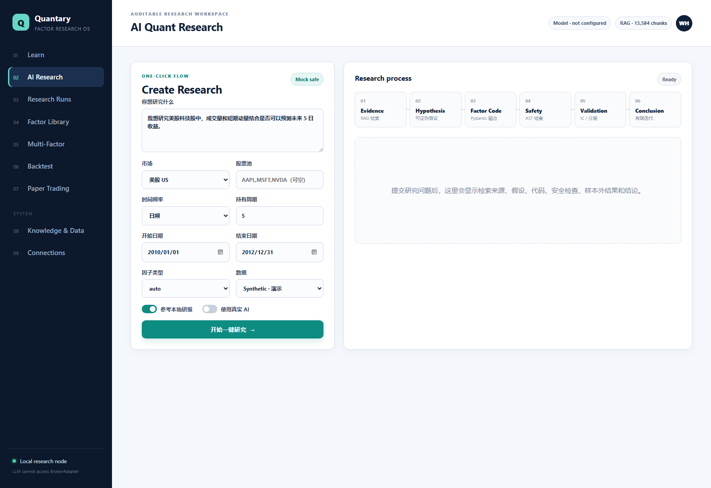
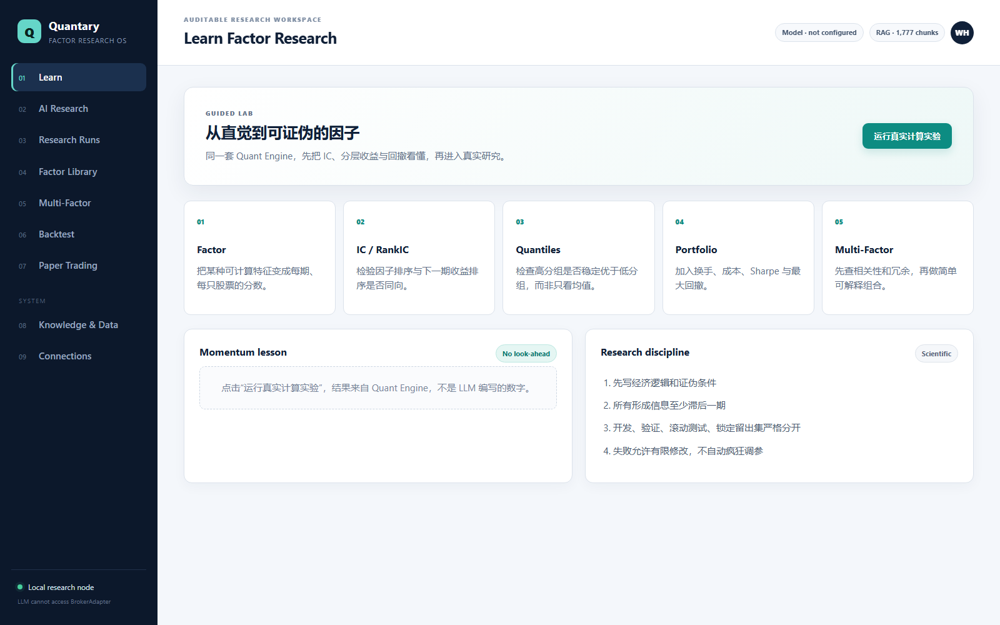
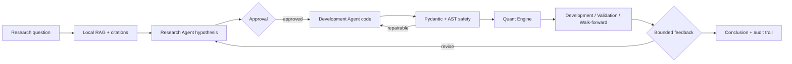

<div align="center">
  
  <h1>Quantary</h1>
  <p><strong>Evidence-grounded AI factor research, with deterministic validation.</strong></p>
  <p>
    <a href="https://github.com/HowrdWng/quant-factor-rd-agent/actions/workflows/ci.yml"></a>
    
    
    
  </p>
</div>

Quantary is a local-first Research–Development workspace for quantitative factor discovery. It turns a
research question and cited evidence into a falsifiable hypothesis, constrained factor code, leakage-aware
evaluation, and an auditable experiment record.

The LLM proposes and explains. The Quant Engine calculates. Generated returns, IC, Sharpe, drawdown, and
quantile results never come from model storytelling.

> Quantary is research software, not investment advice. Live-money execution is intentionally disabled.



## What makes it different

- **One-click AI research:** question → local RAG → hypothesis → factor code → safety → validation → conclusion.
- **Scientific boundaries:** temporal splits, explicit lag requirements, falsification criteria, bounded repair,
  and no unlimited Sharpe optimization.
- **Constrained code generation:** Pydantic contracts plus an AST policy reject imports, file/network/process
  access, dynamic execution, unsafe methods, and unlagged signals.
- **Local research knowledge:** PDF, Markdown, TXT, and notes enter citation-preserving SQLite FTS5 retrieval.
  OHLCV and financial tables stay structured and are loaded through `MarketDataProvider`.
- **Auditable by default:** runs, transitions, decisions, metrics, and artifacts are recorded in SQLite.
- **Safe execution boundary:** the LLM never receives a `BrokerAdapter`; V1 supports backtests and paper trading.

## Product surfaces

| Surface | Purpose |
| --- | --- |
| Learn | Guided Factor → IC / RankIC → Quantiles → Portfolio → Multi-Factor experiments |
| AI Research | Natural-language research with real or mock LLMs and local report citations |
| Research Runs | Immutable event and metric trace for every experiment |
| Factor Library | Save complete, validated factor definitions and implementations |
| Multi-Factor | Correlation, redundancy, IC comparison, equal/positive-IC combinations |
| Backtest | Deterministic temporal evaluation, costs/turnover visibility, locked-holdout boundary |
| Paper Trading | Rule-gated local broker simulation; no live-money permissions |
| Knowledge & Data | Inventory, incremental RAG indexing, retrieval inspection, readiness checks |

<details>
<summary>See the guided Learn workspace</summary>



</details>

## Research flow



## Quick start

Requirements: Python 3.11–3.13. Mock mode needs no API key or external data.

```bash
git clone https://github.com/HowrdWng/quant-factor-rd-agent.git
cd quant-factor-rd-agent
python -m pip install -e ".[dev]"
quant-factor-web --host 127.0.0.1 --port 8000
```

Open <http://127.0.0.1:8000>. Windows users can also double-click `scripts\start_web.cmd` after installation.

Run the deterministic CLI demo:

```bash
quant-factor-agent demo --auto-approve
```

## Use a real model

The easiest local workflow is **Connections → Apply & test connection**, followed by **AI Research → 使用真实
AI**. The API key is kept only in the current service process memory; it is not written to the browser,
SQLite, logs, or Git files.

PowerShell alternative:

```powershell
$env:AGENT_MODE = "live"
$env:LLM_PROVIDER = "openai"
$env:LLM_API_KEY = "your_api_key"
$env:LLM_MODEL = "gpt-4o-mini"
$env:LLM_BASE_URL = "https://api.openai.com/v1"
$env:LLM_API_STYLE = "responses"
quant-factor-agent test-llm
quant-factor-agent demo --mode live --auto-approve
```

OpenAI-compatible providers can use their own base URL, model name, and `chat` or `responses` API style.
Generated JSON still has to pass local schema and code validation.

## Local RAG and market data

```bash
quant-factor-agent scan-data --root /path/to/quant-data
quant-factor-agent index-rag --root /path/to/quant-data
quant-factor-agent watch-rag --root /path/to/quant-data --interval 60
```

Indexing is incremental and resumable. Only complete PDF/Markdown/TXT documents enter the knowledge base;
partial downloads and structured CSV/Excel market rows do not.

The bundled `SyntheticMarketDataProvider` is for demos and tests. Real research should implement or select a
`MarketDataProvider` that supplies point-in-time data and corporate-action-aware returns. See
[`docs/DATA_READINESS.md`](docs/DATA_READINESS.md).

## Docker

```bash
cp .env.example .env
docker compose up --build
```

Set `QUANT_HOST_DATA` in `.env` to mount local datasets read-only at `/datasets`. Runtime databases and
artifacts persist under `./data` and `./artifacts`.

## Architecture and safety

```text
Learn / Research Web UI
          │
       FastAPI
          │
   RD Agent + local RAG ───── citations
          │
   Validated factor code
          │
      Quant Engine ────────── IC / quantiles / backtest
          │
      Risk & Rules
          │
 PaperBrokerAdapter          Live adapter: disabled / pluggable
```

The AST policy is a correctness guard, not a hardened security sandbox. Do not expose the single-user server
directly to the public internet or run untrusted generated code outside an isolated worker. Read
[`SECURITY.md`](SECURITY.md) and [`docs/DEPLOYMENT.md`](docs/DEPLOYMENT.md) before deployment.

## Documentation

- [Product architecture](docs/PRODUCT_ARCHITECTURE.md)
- [Detailed architecture](docs/ARCHITECTURE.md)
- [Live AI guide (中文)](docs/LIVE_AI_GUIDE_CN.md)
- [RAG guide (中文)](docs/RAG_GUIDE_CN.md)
- [Data readiness](docs/DATA_READINESS.md)
- [Open-source adoption notes](docs/ADOPTION_PLAN.md)
- [Third-party design references](THIRD_PARTY.md)
- [Contributing](CONTRIBUTING.md)

## Project status

Quantary v0.3 is a self-hosted, single-user research preview. The current focus is reproducible factor
research, not autonomous trading. Near-term work includes provider adapters, point-in-time data validation,
an isolated generated-code worker, retrieval evaluation, and stronger multi-factor diagnostics.

## Acknowledgements

The architecture studies ideas from Microsoft [RD-Agent](https://github.com/microsoft/RD-Agent) and
[Qlib](https://github.com/microsoft/qlib),
[TradingAgents](https://github.com/TauricResearch/TradingAgents), and
[FinRobot](https://github.com/AI4Finance-Foundation/FinRobot). No verbatim upstream source is vendored; exact
design relationships and licenses are documented in [`THIRD_PARTY.md`](THIRD_PARTY.md).

## License

Apache License 2.0. See [`LICENSE`](LICENSE).
