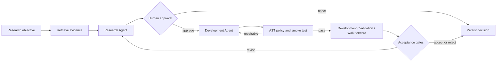

# Architecture

## Research lifecycle



This is a state machine, not a free-form chat chain. Every boundary uses a
Pydantic object, every transition is bounded, and every material output is
persisted as an event.

## Borrowed foundations

- **RD-Agent:** hypothesis, experiment, evaluation, feedback, evolution.
- **TradingAgents:** explicit LangGraph state, conditional routing, resumable
  SQLite checkpoints, structured decisions.
- **Qlib:** separate signal and portfolio analysis records plus experiment
  parameter/metric/artifact logging.
- **FinRobot:** retrieval as a tool with a clean boundary from agent reasoning.

The implementation is intentionally smaller than the upstream frameworks. This
keeps the project understandable in a portfolio review and lets the existing
  Quant Engine remain the deterministic strategy layer.

## Retrieval and structured data

`LocalKnowledgeBase` incrementally extracts complete PDF/Markdown/TXT documents into SQLite FTS5. Every
retrieved chunk retains its source path and PDF page. `DataCatalogTool` separately reads table/column metadata,
and `MarketDataProvider` loads actual OHLCV/financial panels. Structured market rows are not embedded.

## Data access boundary

`TemporalDataVault` owns the chronological data split:

```text
60% development | 20% validation | 10% walk-forward | 10% locked holdout
```

The graph can access only the first three splits. Holdout access requires an
approved/accepted run and an opaque one-shot token. A future release will also
persist the one-shot claim in the experiment database so it remains enforced
across processes.

## Generated-code boundary

The development runtime keeps the original contract and adds one compatible structured-data contract:

```python
def compute_factor(monthly_returns):
    ...
    return factor_dataframe

def compute_factor(market_data):
    # market_data["returns"], ["close"], ["volume"], ... are aligned DataFrames
    ...
    return factor_dataframe
```

The AST policy rejects imports, file/network/process primitives, dynamic
execution, comprehensions, loops, dunder access, unsupported dataframe methods,
and signals without a constant lag of at least one period. It is a correctness
guard, not a security sandbox. Real LLM-generated code will run in a locked-down
Docker worker in a later milestone.
